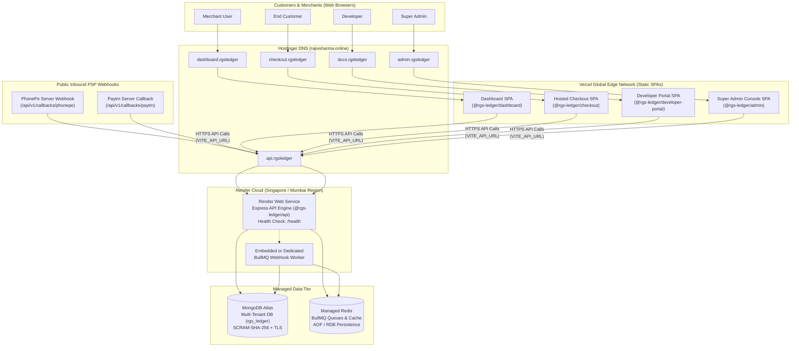
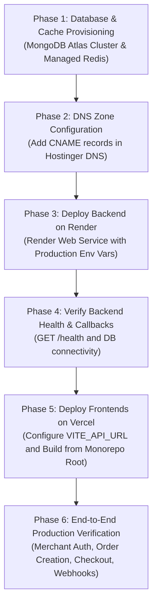

# RGS LEDGER — PRODUCTION DEPLOYMENT ARCHITECTURE AUDIT & SPECIFICATION

**Document Version:** 1.0.0  
**Audit Date:** 2026-11-06  
**Auditor:** Principal Fintech Systems Architect & DevOps Security Engineer  
**Monorepo Target:** RGS Ledger Autonomous Payment Platform  
**Target Infrastructure:** Vercel (Frontends) + Render (Backend & Workers) + MongoDB Atlas + Managed Redis + Hostinger DNS  

---

## 1. Executive Summary & Recommended Deployment Architecture

This audit evaluates the deployment readiness of the complete RGS Ledger monorepo against the proposed production topology:
- **Frontend Applications (4):** Merchant Dashboard, Hosted Checkout, Developer Portal, and Admin Console deployed as Jamstack Single Page Applications (SPAs) on **Vercel Edge Network**.
- **Backend API & Processing:** Node.js/Express REST API on **Render Web Service** with BullMQ worker queue processing backed by **Managed Redis**.
- **Data Tier:** Fully managed **MongoDB Atlas** Replica Set (WiredTiger engine) and **Managed Redis** (with persistence enabled).
- **DNS & Edge Routing:** Custom domains managed on **Hostinger DNS** with automatic TLS/SSL termination via Let's Encrypt at Vercel and Render edge layers.



---

## 2. Application Deployment Matrix

Every application in the monorepo has been inspected. The matrix below defines the exact package configurations, framework targets, build outputs, and dependencies:

| Application Name | Framework / Stack | Package Name | Root Build Command | App Start Command | Output Directory | Runtime Target | Workspace Dependencies |
| :--- | :--- | :--- | :--- | :--- | :--- | :--- | :--- |
| **Merchant Dashboard** | React 18 + Vite + TailwindCSS | `@rgs-ledger/dashboard` | `npm run --workspace=packages/shared build && npm run --workspace=@rgs-ledger/dashboard build` | N/A (Static SPA) | `apps/dashboard/dist` | Browser / Vercel Edge | `@rgs-ledger/shared` |
| **Hosted Checkout** | React 18 + Vite + TailwindCSS | `@rgs-ledger/checkout` | `npm run build:packages && npm run --workspace=@rgs-ledger/checkout build` | N/A (Static SPA) | `apps/checkout/dist` | Browser / Vercel Edge | `@rgs-ledger/shared`, `@rgs-ledger/payment-core` |
| **Developer Portal** | React 18 + Vite + TailwindCSS | `@rgs-ledger/developer-portal` | `npm run --workspace=packages/shared build && npm run --workspace=@rgs-ledger/developer-portal build` | N/A (Static SPA) | `apps/developer-portal/dist` | Browser / Vercel Edge | `@rgs-ledger/shared` |
| **Admin Console** | React 18 + Vite + TailwindCSS | `@rgs-ledger/admin` | `npm run --workspace=packages/shared build && npm run --workspace=@rgs-ledger/admin build` | N/A (Static SPA) | `apps/admin/dist` | Browser / Vercel Edge | `@rgs-ledger/shared` |
| **REST API Server** | Node.js 20+ Express + Mongoose + BullMQ | `@rgs-ledger/api` | `npm run build:packages && npm run --workspace=@rgs-ledger/api build` | `npm run --workspace=@rgs-ledger/api start` (`node dist/server.js`) | `apps/api/dist` | Node.js 20+ / Render Web Service | `@rgs-ledger/shared`, `@rgs-ledger/payment-core` |
| **Shared Domain Core** | TypeScript Library | `@rgs-ledger/shared` | `npm run --workspace=packages/shared build` | N/A (Library) | `packages/shared/dist` | Node.js & Browser | None |
| **Payment Core Engine**| TypeScript Library | `@rgs-ledger/payment-core` | `npm run --workspace=packages/payment-core build` | N/A (Library) | `packages/payment-core/dist` | Node.js | `@rgs-ledger/shared`, `upipay@1.0.0` |
| **Node.js Merchant SDK**| TypeScript Library | `@rgs-ledger/sdk-node` | `npm run --workspace=packages/sdk-node build` | N/A (Library) | `packages/sdk-node/dist` | Node.js | None |
| **React Component SDK**| React 18 Library | `@rgs-ledger/sdk-react` | `npm run --workspace=packages/sdk-react build` | N/A (Library) | `packages/sdk-react/dist` | Browser | None |

---

## 3. Exact Build & Start Commands

All commands are derived strictly from the monorepo root [`package.json`](file:///d:/Coding/project/RGS_PAY/package.json) and individual workspace package definitions:

### A. Full Monorepo Build Command
```bash
npm run build
```
*Executes `npm run build --workspaces --if-present`, compiling all packages and Vite applications in dependency order.*

### B. Core Shared Packages Build Command
```bash
npm run build:packages
```
*Compiles `@rgs-ledger/shared`, `@rgs-ledger/payment-core`, `@rgs-ledger/sdk-node`, and `@rgs-ledger/sdk-react` via `tsc`.*

### C. Vercel Build Commands (Configured in Vercel Project Settings)
Because all four frontends depend on `packages/shared` and `packages/payment-core`, the Vercel **Root Directory** must remain `.` (monorepo root), and the following exact commands should be set:

1. **Merchant Dashboard Project:**
   - **Build Command:** `npm run --workspace=packages/shared build && npm run --workspace=@rgs-ledger/dashboard build`
   - **Output Directory:** `apps/dashboard/dist`
   - **Install Command:** `npm install`

2. **Hosted Checkout Project:**
   - **Build Command:** `npm run build:packages && npm run --workspace=@rgs-ledger/checkout build`
   - **Output Directory:** `apps/checkout/dist`
   - **Install Command:** `npm install`

3. **Developer Portal Project:**
   - **Build Command:** `npm run --workspace=packages/shared build && npm run --workspace=@rgs-ledger/developer-portal build`
   - **Output Directory:** `apps/developer-portal/dist`
   - **Install Command:** `npm install`

4. **Admin Console Project:**
   - **Build Command:** `npm run --workspace=packages/shared build && npm run --workspace=@rgs-ledger/admin build`
   - **Output Directory:** `apps/admin/dist`
   - **Install Command:** `npm install`

### D. Render Web Service Commands (Express API)
- **Environment:** Node
- **Build Command:** `npm install && npm run build:packages && npm run --workspace=@rgs-ledger/api build`
- **Start Command:** `npm run --workspace=@rgs-ledger/api start`
- **Health Check Path:** `/health`

---

## 4. Required Environment Variable Matrix

### A. Build-Time Environment Variables (Vercel Frontends)
> [!IMPORTANT]
> Vite embeds `VITE_*` variables into static JavaScript assets during `vite build`. They must be set in the Vercel dashboard prior to triggering the production deployment.

| Application | Variable Name | Required Value | Classification | Scope |
| :--- | :--- | :--- | :--- | :--- |
| Dashboard | `VITE_API_URL` | `https://api.rgsledger.rajivsharma.online/api/v1` | Public Endpoint | Build-Time |
| Checkout | `VITE_API_URL` | `https://api.rgsledger.rajivsharma.online/api/v1` | Public Endpoint | Build-Time |
| Developer Portal | `VITE_API_URL` | `https://api.rgsledger.rajivsharma.online/api/v1` | Public Endpoint | Build-Time |
| Admin Console | `VITE_API_URL` | `https://api.rgsledger.rajivsharma.online/api/v1` | Public Endpoint | Build-Time |

---

### B. Runtime Environment Variables (Render Web Service)
> [!CAUTION]
> In production (`NODE_ENV=production` or `PAYMENT_ENVIRONMENT=LIVE`), the platform startup validator will **refuse to boot** if secrets are missing, too short, or use development defaults.

| Variable Name | Required Production Format / Constraint | Sensitivity | Purpose |
| :--- | :--- | :---: | :--- |
| `NODE_ENV` | `production` | Public | Enforces production mode, secure cookies, and error redaction. |
| `PAYMENT_ENVIRONMENT` | `LIVE` (or `SANDBOX` for pre-launch staging) | Public | Global processing mode. When `LIVE`, real money flows. |
| `API_PORT` | `10000` (Render default port) | Public | Port on which Express server binds. |
| `API_URL` | `https://api.rgsledger.rajivsharma.online` | Public | Backend public URL for callbacks and internal routing. |
| `PUBLIC_API_BASE_URL` | `https://api.rgsledger.rajivsharma.online` | Public | External base URL for upstream PSP webhook registration. |
| `DASHBOARD_URL` | `https://dashboard.rgsledger.rajivsharma.online` | Public | CORS allowed origin and merchant redirect target. |
| `CHECKOUT_URL` | `https://checkout.rgsledger.rajivsharma.online` | Public | CORS allowed origin and customer payment page URL. |
| `DEVELOPER_PORTAL_URL`| `https://docs.rgsledger.rajivsharma.online` | Public | CORS allowed origin for API tester. |
| `ADMIN_URL` | `https://admin.rgsledger.rajivsharma.online` | Public | CORS allowed origin for Super Admin operations. |
| `MONGODB_URI` | `mongodb+srv://<user>:<password>@<cluster>.mongodb.net/rgs_ledger?retryWrites=true&w=majority` | **Secret** | Authenticated MongoDB Atlas connection string. |
| `REDIS_URL` | `rediss://default:<password>@<redis-host>:<port>` | **Secret** | Authenticated, TLS-encrypted Redis connection string for BullMQ. |
| `ENCRYPTION_KEY` | **Exactly 64 Hexadecimal Characters (32 Bytes)** | **Secret** | Master AES-256-GCM key used to encrypt merchant provider credentials at rest. |
| `JWT_ACCESS_SECRET` | Cryptographically random string (>= 32 chars) | **Secret** | Signs 15-minute access tokens. |
| `JWT_REFRESH_SECRET` | Cryptographically random string (>= 32 chars, distinct from access) | **Secret** | Signs 7-day refresh tokens. |
| `COOKIE_SECRET` | Cryptographically random string (>= 32 chars) | **Secret** | Session cookie signing secret. |
| `WEBHOOK_SIGNING_SECRET`| Cryptographically random string (>= 24 chars) | **Secret** | Fallback HMAC key for platform system webhooks. |
| `DEFAULT_CURRENCY` | `INR` | Public | Base currency. Stored in integer paise minor units. |
| `STORAGE_PROVIDER` | `local` (or `s3`) | Config | Document upload storage driver. |

---

## 5. Domain & Hostinger DNS Configuration

Domain: **`rajivsharma.online`**  
DNS Provider: **Hostinger DNS Zone Editor**

### Required DNS Records Table

| Host / Name | Record Type | TTL | Target / Destination | Destination Service |
| :--- | :---: | :---: | :--- | :--- |
| `dashboard.rgsledger` | **CNAME** | 300 | `cname.vercel-dns.com` | Vercel (Merchant Dashboard) |
| `checkout.rgsledger` | **CNAME** | 300 | `cname.vercel-dns.com` | Vercel (Hosted Checkout) |
| `docs.rgsledger` | **CNAME** | 300 | `cname.vercel-dns.com` | Vercel (Developer Portal) |
| `admin.rgsledger` | **CNAME** | 300 | `cname.vercel-dns.com` | Vercel (Admin Console) |
| `api.rgsledger` | **CNAME** | 300 | `<your-render-service-name>.onrender.com` | Render (Express API) |

### SSL / TLS Configuration
1. **Vercel Domains:** Free, automated Let's Encrypt Wildcard / SNI certificates are automatically provisioned upon CNAME verification.
2. **Render Domains:** Free, automated Let's Encrypt certificates are provisioned within 5-10 minutes of pointing the CNAME record in Hostinger.
3. **End-to-End Encryption:** Strict HTTPS is enforced at both Vercel and Render edge gateways.

---

## 6. Technical Audit Findings & Evaluation

### A. npm Workspace Dependency Resolution
- **Finding:** The monorepo uses npm workspaces (`packages/*`, `apps/*`, `integrations/*`) with local file references in `package.json` (`"@rgs-ledger/shared": "file:../../packages/shared"`).
- **Vercel Build Behavior:** If Vercel projects are configured with Root Directory set to an app subfolder (e.g. `apps/dashboard`), the build will fail because npm cannot resolve `../../packages/shared` without parent context.
- **Solution:** Set Vercel Root Directory to `.` (repository root) or enable Vercel Monorepo settings with the root install command (`npm install`).

### B. SPA Routing & 404 Refresh Behavior
- **Finding:** React Router v6 handles client-side routing on all four frontends (`/transactions`, `/pay/:sessionId`, `/settlements`).
- **Risk:** Without server rewrites, refreshing a page at `https://dashboard.rgsledger.rajivsharma.online/transactions` returns a Vercel 404 NOT_FOUND because static files are served directly.
- **Requirement:** Each frontend requires a `vercel.json` rewrite file:
  ```json
  {
    "rewrites": [
      { "source": "/(.*)", "destination": "/index.html" }
    ]
  }
  ```

### C. Render Port Binding (`API_PORT` vs `PORT`)
- **Finding:** In [`apps/api/src/config/index.ts#L19`](file:///d:/Coding/project/RGS_PAY/apps/api/src/config/index.ts#L19), the server reads `port: parseInt(process.env.API_PORT || '4000', 10)`.
- **Render Standard:** Render automatically sets `PORT=10000` inside web service containers.
- **Resolution:** Render environment variables MUST include `API_PORT=10000`, or `config.port` should support `process.env.PORT || process.env.API_PORT || '4000'`.

### D. Background Worker & BullMQ Queue Processing
- **Finding:** Currently, BullMQ queue and worker are **embedded** in the Express server process via `initWebhookQueue()` in [`apps/api/src/server.ts`](file:///d:/Coding/project/RGS_PAY/apps/api/src/server.ts).
- **Evaluation of Proposed Infrastructure:**
  - The project does **not** currently have a standalone worker file (e.g. `src/worker.ts`).
  - Deploying a separate Render Background Worker would require adding a dedicated worker entry point.
  - **Recommendation:** Run the embedded BullMQ worker within the Render Web Service initially (which handles up to several thousand webhook deliveries per minute with zero additional hosting cost). When transaction volume scales, extract a standalone `worker.ts` and launch a dedicated Render Background Worker.

### E. MongoDB Connection Pooling & Resilience
- **Finding:** In [`apps/api/src/database/connection.ts`](file:///d:/Coding/project/RGS_PAY/apps/api/src/database/connection.ts), Mongoose connects with `serverSelectionTimeoutMS: 3000`.
- **Atlas Shared Tier (M0/M2/M5):** Atlas free/shared tiers limit concurrent connections to 500. On container restarts or scaling, Mongoose default `maxPoolSize` is 100 per container. Setting `maxPoolSize: 20` via connection URI parameters is recommended (`?maxPoolSize=20&w=majority`).

### F. CORS & Cross-Subdomain Cookies
- **Finding:** The API sets cookies (`rgs_access_token`, `rgs_refresh_token`) with `sameSite: 'lax'`.
- **Frontend Behavior:** In [`apps/dashboard/src/services/api.ts`](file:///d:/Coding/project/RGS_PAY/apps/dashboard/src/services/api.ts), requests pass `credentials: 'include'` AND attach `Authorization: Bearer <token>` from `localStorage`.
- **Status:** Fully functional. Because both API and frontends share the eTLD+1 root domain (`rajivsharma.online`), requests are considered Same-Site. Furthermore, dual-token authorization (Bearer header + Cookie fallback) ensures zero auth failures even if third-party cookies are restricted.

### G. Public Provider Callbacks
- **Finding:** External PSPs (PhonePe and Paytm) deliver server-to-server webhook notifications via HTTP POST.
- **Public Endpoints:**
  - PhonePe: `https://api.rgsledger.rajivsharma.online/api/v1/callbacks/phonepe`
  - Paytm: `https://api.rgsledger.rajivsharma.online/api/v1/callbacks/paytm`
- **Security Check:** Both endpoints are publicly routable and protected by raw cryptographic HMAC-SHA256 signature verification (`x-verify` and `CHECKSUMHASH`), followed by authoritative Status API double-checks.

---

## 7. Recommended Step-by-Step Deployment Sequence



### Phase 1: Database & Cache Setup
1. Create a MongoDB Atlas cluster (M0 free or M10 production). Create a database user `rgs_prod_user` and whitelist IP access (`0.0.0.0/0` with SCRAM-SHA-256 authentication).
2. Provision a Managed Redis instance (Render Redis or Upstash). Record the `rediss://...` connection URL.

### Phase 2: Hostinger DNS Setup
1. In Hostinger Control Panel -> **DNS Zone Editor**, add the 5 CNAME records listed in Section 5.

### Phase 3: Deploy Backend on Render
1. Connect the GitHub repository to Render.
2. Select **Web Service** with Node runtime.
3. Set Build Command: `npm install && npm run build:packages && npm run --workspace=@rgs-ledger/api build`
4. Set Start Command: `npm run --workspace=@rgs-ledger/api start`
5. Configure Environment Variables (Section 4.B). Set `API_PORT=10000`.
6. Add custom domain `api.rgsledger.rajivsharma.online` and verify SSL certificate.

### Phase 4: Verify Backend Health
1. Probe health check: `curl -I https://api.rgsledger.rajivsharma.online/health` (must return HTTP 200).
2. Run database validation: Ensure MongoDB connection is established in Render server logs.

### Phase 5: Deploy Frontends on Vercel
1. Create 4 separate Vercel projects linked to the same repository.
2. Set Root Directory to `.` (monorepo root).
3. Set project build commands and output directories as detailed in Section 3.C.
4. Set `VITE_API_URL=https://api.rgsledger.rajivsharma.online/api/v1` in all 4 Vercel projects.
5. Add custom domains:
   - `dashboard.rgsledger.rajivsharma.online`
   - `checkout.rgsledger.rajivsharma.online`
   - `docs.rgsledger.rajivsharma.online`
   - `admin.rgsledger.rajivsharma.online`

### Phase 6: Post-Deployment Smoke Test
1. Access `https://dashboard.rgsledger.rajivsharma.online` -> Register a test merchant.
2. Access `https://admin.rgsledger.rajivsharma.online` -> Verify admin login.
3. Access `https://docs.rgsledger.rajivsharma.online` -> Verify API documentation.
4. Create an order and verify Hosted Checkout loads at `https://checkout.rgsledger.rajivsharma.online/pay/<id>`.

---

## 8. Identified Risks & Recommendations

| Item | Risk Level | Description | Recommendation |
| :--- | :---: | :--- | :--- |
| **Vercel SPA 404 on Refresh** | **High** | Without rewrite configuration, direct navigation or page refresh on `/transactions` or `/pay/:id` triggers Vercel 404. | Add `vercel.json` with `{"rewrites": [{"source": "/(.*)", "destination": "/index.html"}]}` to each frontend app. |
| **Render `PORT` vs `API_PORT`** | **Medium** | Render assigns dynamic `PORT=10000`. If `API_PORT` is omitted in Render env vars, Express listens on port 4000 and fails health checks. | Explicitly define `API_PORT=10000` in Render environment variables. |
| **BullMQ Worker Process** | **Low** | The monorepo has no separate worker script; worker runs embedded in API server. | Maintain embedded worker for initial production; split into standalone worker only when scaling requires separate infrastructure. |
| **CORS Trailing Slashes** | **Medium** | CORS origin array checks exact strings (`config.dashboardUrl`). Trailing slashes cause CORS rejections. | Ensure environment variable URLs have no trailing slashes (e.g. `https://dashboard...`, not `https://dashboard.../`). |
| **Database Max Pool Size** | **Low** | MongoDB Atlas connections could exceed limits during container spikes. | Append `?maxPoolSize=25` to the `MONGODB_URI` connection string. |
