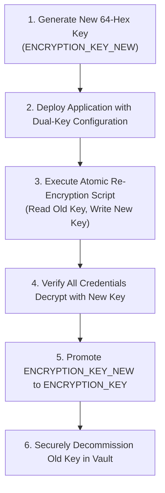

# RGS LEDGER — LOCAL & PRODUCTION ENVIRONMENT CONFIGURATION GUIDE

**Document ID:** `RGS-ENV-2026-11-06`  
**Platform:** RGS Ledger — Enterprise Fintech Payment Gateway Platform  
**Target Audience:** DevOps Engineers, Platform Architects, Security Auditors, Merchants  
**Security Classification:** Platform Architecture & Security Reference  

---

## 1. Overview & Architectural Philosophy

RGS Ledger is an enterprise multi-tenant payment gateway platform built with a modular, provider-independent payment engine.

### Core Operating Tenets:
1. **Multi-Merchant Isolation:** Platform-level environment variables configure infrastructure (MongoDB, Redis, JWT signing keys, master AES-256-GCM encryption key, public callback endpoints). Individual merchant provider accounts (PhonePe MIDs, Paytm credentials, merchant-specific VPAs) are stored **AES-256-GCM encrypted** at rest in MongoDB.
2. **Provider Independence:** Core ledger and state machine logic are agnostic of upstream PSPs. RGS Ledger supports PhonePe Business, Paytm Business, Raw UPI QR, and future authorized Card/Netbanking acquirers via unified `IPaymentProvider` interfaces.
3. **Financial Safety & Authoritative Confirmation:** Simulating an action or scanning a QR is NEVER proof of funds. Payments transition to `SUCCESS` only via cryptographically verified callbacks (`x-verify`, checksum) followed by authoritative status API inquiry (`expectedAmount` matching in integer paise), or via audited manual UTR reconciliation for raw QR codes.
4. **Automated Validation Tooling:** A dedicated CLI validation command (`npm run validate:env`) verifies environment variable presence, cryptographic key lengths, and flags insecure development secrets when switching to `LIVE` mode.

---

## 2. Mandatory vs. Optional Variables Directory

### Mandatory Variables (Application Will Not Boot Without These in Production)

| Variable Name | Category | Scope | Format / Constraints | Production Requirement | Purpose |
| :--- | :--- | :--- | :--- | :--- | :--- |
| `NODE_ENV` | Runtime | Platform | `production` \| `development` \| `test` | `production` | Enforces production security headers, TLS cookie flags, and strict error masking. |
| `PAYMENT_ENVIRONMENT` | Gateway | Platform | `SANDBOX` \| `LIVE` | `LIVE` | Global gateway mode. When `LIVE`, real money flows through configured providers; sandbox fallbacks are strictly blocked. |
| `API_URL` | Networking | Platform | Full URL (`https://...`) | Public HTTPS domain | Base REST API endpoint for system callbacks and inter-service routing. |
| `CHECKOUT_URL` | Networking | Platform | Full URL (`https://...`) | Public HTTPS domain | Hosted Checkout customer UI base URL. |
| `DASHBOARD_URL` | Networking | Platform | Full URL (`https://...`) | Public HTTPS domain | Merchant Dashboard CORS origin and redirect base. |
| `MONGODB_URI` | Database | Platform | MongoDB Connection URI | Auth-enabled replica set / Atlas URI | Primary database connection string (MongoDB 6.0+ with WiredTiger). |
| `REDIS_URL` | Queue/Cache| Platform | Redis Connection URI | High-availability Redis instance | Backs BullMQ persistent queues for webhook delivery and background reconciliation. |
| `ENCRYPTION_KEY` | Cryptography| Platform | **Exactly 64 hex characters (32 bytes)** | Cryptographically random hex string | Master AES-256-GCM key used to encrypt merchant provider credentials at rest. |
| `JWT_ACCESS_SECRET` | Auth | Platform | String (>= 32 chars) | High-entropy random secret | Signs 15-minute merchant and admin access tokens. |
| `JWT_REFRESH_SECRET` | Auth | Platform | String (>= 32 chars) | High-entropy random secret (different from access) | Signs 7-day merchant refresh tokens. |
| `COOKIE_SECRET` | Auth | Platform | String (>= 32 chars) | High-entropy random secret | Cookie session signature secret. |
| `WEBHOOK_SIGNING_SECRET`| Auth | Platform | String (>= 24 chars) | High-entropy random secret | System webhook signature key for platform notifications. |

### Optional Platform Fallbacks & Auxiliaries

| Variable Name | Category | Scope | Safe Sandbox Default | Production Behavior |
| :--- | :--- | :--- | :--- | :--- |
| `API_PORT` | Networking | Platform | `4000` | Port assigned by container orchestrator (e.g. AWS ECS / K8s). |
| `DEVELOPER_PORTAL_URL`| Networking | Platform | `http://localhost:5175` | Public docs and developer portal URL. |
| `ADMIN_URL` | Networking | Platform | `http://localhost:5176` | Super Admin console URL. |
| `DEFAULT_CURRENCY` | Financial | Platform | `INR` | ISO 4217 currency code. Amounts stored in minor units (paise). |
| `PHONEPE_MERCHANT_ID` | PhonePe | Fallback | Empty / Optional | Platform fallback PhonePe Merchant ID for platform sandbox. |
| `PHONEPE_SALT_KEY` | PhonePe | Fallback | Empty / Optional | Platform fallback PhonePe Salt Key. |
| `PHONEPE_SALT_INDEX` | PhonePe | Fallback | `1` | Platform fallback Salt Index. |
| `PAYTM_MERCHANT_ID` | Paytm | Fallback | Empty / Optional | Platform fallback Paytm Merchant ID. |
| `PAYTM_MERCHANT_KEY` | Paytm | Fallback | Empty / Optional | Platform fallback Paytm Merchant Key. |
| `DEFAULT_MERCHANT_VPA`| Raw UPI QR | Fallback | Empty / Optional | Fallback VPA for raw QR simulation. |

---

## 3. How to Generate Cryptographically Secure Secrets

Never use dictionary words, predictable strings, or placeholders (`replace_with_...`) in production.

### Using OpenSSL (CLI)

```bash
# 1. Master AES-256-GCM Encryption Key (Required: Exactly 64 Hexadecimal Characters / 32 Bytes)
openssl rand -hex 32

# 2. JWT Access Secret (High entropy, minimum 32 characters)
openssl rand -base64 32

# 3. JWT Refresh Secret (High entropy, distinct from Access Secret)
openssl rand -base64 32

# 4. Cookie Secret (Minimum 32 characters)
openssl rand -base64 32

# 5. Webhook Signing Secret (Minimum 24 characters)
openssl rand -hex 24
```

### Using Node.js (Built-in Crypto)

```bash
# Generate 64-hex character encryption key:
node -e "console.log(require('crypto').randomBytes(32).toString('hex'))"

# Generate 32-character random secret:
node -e "console.log(require('crypto').randomBytes(24).toString('base64'))"
```

---

## 4. How to Configure Sandbox Credentials

For local development and testing, sandbox mode allows end-to-end payment simulations without live bank accounts:

1. **Create Local `.env` File:**
   ```bash
   cp .env.example .env
   ```
2. **Set Sandbox Mode:**
   ```dotenv
   NODE_ENV=development
   PAYMENT_ENVIRONMENT=SANDBOX
   ```
3. **Configure Local Services:**
   - Start MongoDB: `mongod --dbpath <data_dir>` or Docker container on port `27017`.
   - Start Redis: `redis-server` or Docker container on port `6379`.
4. **Platform Sandbox Provider (Optional Fallbacks):**
   - For simulated UPI checkout testing, leave provider keys empty to use the built-in RGS Ledger sandbox provider.
   - For PhonePe UAT sandbox testing, use PhonePe's official test credentials:
     - `PHONEPE_MERCHANT_ID=PGTESTPAYUAT`
     - `PHONEPE_SALT_KEY=099eb0cd-02cf-4e2a-8aca-3e6c6aff0399`
     - `PHONEPE_SALT_INDEX=1`
     - `PHONEPE_ENV=sandbox`
5. **Verify Local Configuration:**
   ```bash
   npm run validate:env
   ```
   The validator will confirm that development settings are valid for sandbox operation.

---

## 5. How to Configure Production Credentials Securely

In a live production fintech environment:

### Step 1: Enforce Production Mode
```dotenv
NODE_ENV=production
PAYMENT_ENVIRONMENT=LIVE
```

### Step 2: Zero-Trust Secret Injection
- **Never commit `.env` or production credentials to Git.**
- Inject secrets into container environments dynamically at runtime using an enterprise secret vault:
  - **AWS Systems Manager Parameter Store / AWS Secrets Manager**
  - **HashiCorp Vault**
  - **Google Cloud Secret Manager**
  - **Kubernetes SealedSecrets / External Secrets Operator**

### Step 3: Configure Public HTTPS Domains
In `LIVE` mode, the platform refuses to boot if service URLs point to `localhost` or `127.0.0.1`:
```dotenv
API_URL=https://api.rgsledger.com
CHECKOUT_URL=https://checkout.rgsledger.com
DASHBOARD_URL=https://dashboard.rgsledger.com
```

### Step 4: Merchant-Specific Live Provider Configuration
Because RGS Ledger is multi-tenant:
- Individual merchants configure their own PhonePe or Paytm production credentials through the Merchant Dashboard (**Settings -> Payment Providers**) or via API (`POST /api/v1/merchant/providers`).
- Credentials are encrypted on ingestion via `ENCRYPTION_KEY` using AES-256-GCM.
- Platform fallbacks in `.env` should remain unconfigured or restricted to platform-level acquiring.

---

## 6. Master Encryption Key Rotation Procedure

The master `ENCRYPTION_KEY` encrypts merchant provider credentials at rest. When compliance or security policy requires key rotation, execute the following dual-key rotation procedure:



### Step-by-Step Rotation Process:
1. **Generate New 256-bit Key:**
   ```bash
   openssl rand -hex 32
   ```
2. **Dual-Key Staging:**
   Set `ENCRYPTION_KEY_OLD` (current key) and `ENCRYPTION_KEY_NEW` (new key) in your secrets manager.
3. **Run Re-encryption Migration:**
   Execute the migration script:
   - Queries all `MerchantProviderAccount` documents.
   - Decrypts `credentialsEncrypted` using `ENCRYPTION_KEY_OLD`.
   - Re-encrypts credentials using `ENCRYPTION_KEY_NEW`.
   - Atomically updates documents and records `lastRotatedAt: new Date()`.
4. **Promote New Key:**
   Set `ENCRYPTION_KEY=<new_key>` and remove the old key from the runtime environment.
5. **Audit:**
   Check `AuditLog` records for `KEY_ROTATION_COMPLETED` entries.

---

## 7. Configuration Validation Command

Run the configuration validator at any time:

```bash
npm run validate:env
```

The validator verifies:
- Format and reachability of MongoDB and Redis connection URIs.
- Strict 64-hex character requirement for `ENCRYPTION_KEY`.
- Minimum entropy thresholds (>= 32 chars) for JWT and cookie secrets.
- In `LIVE` mode:
  - Fails if any development default or placeholder string is detected.
  - Fails if sandbox provider credentials (`PGTESTPAYUAT`, `STAGE_MID...`) are present.
  - Fails if service URLs point to `localhost`.
