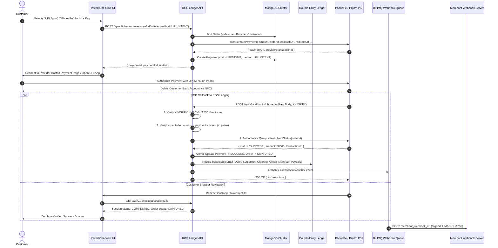
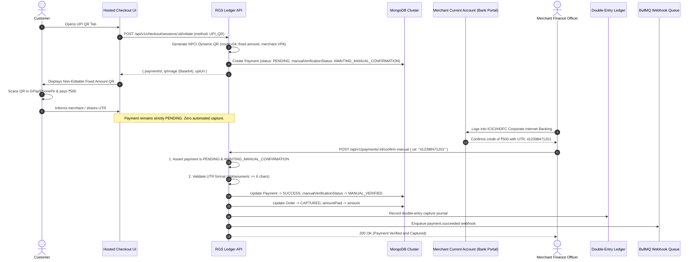

# RGS LEDGER — SERVER-AUTHORITATIVE PAYMENT CONFIRMATION FLOW

**Document ID:** `RGS-FLOW-CONFIRMATION-2026-11`  
**Platform:** RGS Ledger — Enterprise Fintech Platform  
**Security Classification:** Core Financial Safety Standard  

---

## 1. Fintech Safety Principles

In commercial fintech engineering, **client-side events are never evidence of money receipt**. 
- A customer viewing a QR code is not evidence of payment.
- A customer clicking "I have paid" is not evidence of payment.
- A browser redirect returning from a gateway is not evidence of payment.
- A webhook payload claiming `SUCCESS` without cryptographic signature verification and independent status inquiry is not evidence of payment.

RGS Ledger strictly enforces **Server-Authoritative Confirmation**:

```
[Inbound Callback] ──> [Signature Verification] ──> [Amount & Identity Check] ──> [Independent Status Query] ──> [Double-Entry Capture]
```

---

## 2. Sequence Diagram: Automated PSP Payment Flow (PhonePe / Paytm)



---

## 3. Sequence Diagram: Raw UPI QR Flow (Manual Bank Verification)



---

## 4. Key Security Controls in Payment Resolution

### 4.1 Amount Substitution Protection (`expectedAmount`)
In payment gateway attacks, an adversary modifies the client payment to pay ₹1.00 on the provider page and then transmits the legitimate ₹1.00 webhook to fulfill a ₹10,000 order.
- In RGS Ledger, both `verifyWebhook()` and `checkStatus()` enforce `expectedAmount: payment.amount`.
- If the PSP callback contains `amount: 100` but the order requires `1000000`, the callback is rejected with `401 Unauthorized` and logged as a security alert.

### 4.2 Constant-Time Signature Comparison
All signature verifications use `crypto.timingSafeEqual`:
```typescript
const bufProvided = Buffer.from(providedSignature, 'hex');
const bufExpected = Buffer.from(expectedSignature, 'hex');
if (bufProvided.length !== bufExpected.length) return false;
return crypto.timingSafeEqual(bufProvided, bufExpected);
```
This eliminates timing side-channel attacks that could allow attackers to deduce valid signatures byte-by-byte.

### 4.3 Defense-in-Depth Status Query
Even when an incoming webhook carries a cryptographically valid signature, RGS Ledger queries the provider's authoritative Status API (`client.checkStatus()`) before recording ledger entries. This protects against compromised callback URLs and rogue webhook replay.

### 4.4 Automated Reconciliation (`reconcilePayment`)
For payments that remain in `PENDING` due to customer drop-off or network timeouts, the background reconciliation worker polls the provider Status API:
```typescript
const status = await provider.verifyPayment(payment.providerPaymentId, payment.amount);
if (status.status === PaymentStatus.SUCCESS) {
  await PaymentService.resolvePayment({ paymentId, action: 'SUCCESS' });
}
```
Transactions are never prematurely failed or cancelled on network timeouts.
