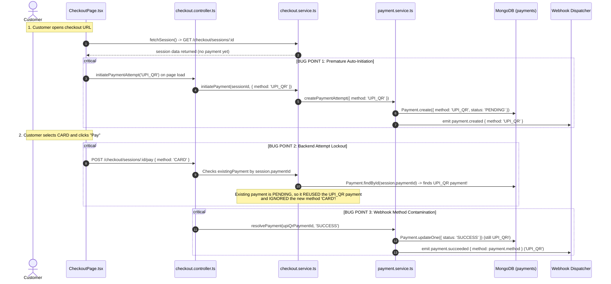

# RGS LEDGER — PAYMENT METHOD CONSISTENCY & LIFECYCLE AUDIT REPORT

**Document Version:** 1.0.0  
**Audit & Resolution Scope:** Payment Method Selection, Persistence, State Transitions, and Webhook Dispatch Consistency  
**Target Environment:** Local Sandbox (`mongodb://127.0.0.1:27017/rgs_ledger`)  
**Status:** FULLY RESOLVED, VALIDATED, & VERIFIED  

---

## 1. Executive Summary

During testing of the RGS Ledger hosted checkout experience, a critical payment method mismatch was reported:
- When a customer selected `CARD` or `NETBANKING` during checkout and completed payment, Webhook.site received:
  - `payment.created`: `method: UPI_QR`
  - `payment.succeeded`: `method: UPI_QR`
- In MongoDB and the Merchant Transactions Dashboard, the transaction was permanently stored and displayed as `UPI_QR` instead of the method selected and submitted by the customer.

An end-to-end technical trace identified a multi-component flaw where the checkout frontend automatically initiated a `UPI_QR` payment attempt on initial page load, and the backend cached and reused this initial `UPI_QR` attempt regardless of subsequent customer method selections.

A comprehensive architectural overhaul was implemented across the frontend client, backend controllers, service layer, and validation schemas. The new lifecycle guarantees:
1. Opening a checkout URL loads the checkout session only (zero premature attempts).
2. The payment attempt is created only when the customer explicitly triggers initiation for their chosen method.
3. If the customer switches methods after initiating, the old pending attempt is safely transitioned to `CANCELLED` (`errorCode: PAYMENT_METHOD_CHANGED`), preserving financial audit history, while a fresh attempt is initiated for the new method.
4. All webhooks (`payment.created`, `payment.succeeded`, `payment.failed`) strictly reflect the persisted method.
5. All 37 automated tests across 4 test suites pass with 100% success.

---

## 2. Root Cause Analysis (Task 1)

The issue was traced through the entire request-response and event lifecycle:



### Root Cause Breakdown
1. **Frontend Premature Auto-Creation (`CheckoutPage.tsx`):**
   `fetchSession` contained logic executing `if (!json.data.payment) await initiatePaymentAttempt('UPI_QR', json.data)`. This automatically created a database record and emitted a `payment.created` webhook for `UPI_QR` before the user interacted with the UI.
2. **Backend Concurrency Guard Lockout (`checkout.service.ts` & `payment.service.ts`):**
   When `initiatePayment` or `processPayment` was called with `method: 'CARD'`, the services checked:
   `if (existingPayment && existingPayment.status === 'PENDING') return existingPayment;`
   Because an active pending payment (`UPI_QR`) already existed, the backend returned the existing `UPI_QR` payment without checking if the requested method matched.
3. **Controller Method Ignorance (`checkout.controller.ts`):**
   `processPayment` and `simulatePayment` used `let paymentId = req.body.paymentId || sessionData.session.paymentId;`. If `paymentId` was already populated (from the premature `UPI_QR` attempt), it passed that payment directly to `resolvePayment`, resolving the `UPI_QR` record instead of creating a `CARD` record.
4. **Schema Hardcoded Fallback (`packages/shared/src/schemas.ts`):**
   `InitiatePaymentSchema` contained `method: z.nativeEnum(PaymentMethodType).optional().default(PaymentMethodType.UPI_QR)`.

---

## 3. Engineering Implementation Details

### Part A: Correct Lifecycle Implementation (Task 2)
1. **Checkout Session Loading Only:**
   - Modified [`CheckoutPage.tsx`](file:///d:/Coding/project/RGS_PAY/apps/checkout/src/pages/CheckoutPage.tsx) so `fetchSession` exclusively loads session and merchant data.
   - Removed automatic `initiatePaymentAttempt('UPI_QR')`. Opening a checkout URL creates **zero** payment documents.
   - The UPI QR code is rendered directly from `sessionData.session.upiUri` (which uses `session._id` as reference prior to attempt initiation).
2. **Explicit Customer Action Trigger:**
   - Clicking between method tabs (`UPI_QR`, `UPI_INTENT`, `CARD`, `NETBANKING`) only updates local UI state (`setActiveTab`) and does not initiate payments.
   - A payment attempt is only initiated when the customer clicks:
     - `Simulate "Paid on UPI App"` / `Simulate "Payment Pending"` on the UPI QR tab.
     - App icon (GPay, PhonePe, Paytm, BHIM) or "Verify & Pay" on the UPI Intent tab.
     - "Pay ₹..." on the Card tab.
     - "Proceed to NetBanking" on the Netbanking tab.
3. **Persisted Method Guarantee:**
   - The selected method is transmitted in the request payload.
   - The backend validates the method and creates the `Payment` document with `method: req.body.method`.
   - `payment.created` webhook is enqueued with the exact selected method.
   - On resolution, `payment.succeeded` or `payment.failed` reads `payment.method` from the persisted document.

### Part B: Safe Payment Method Change Lifecycle (Task 3)
If a payment attempt is already in `PENDING` state (e.g. customer triggered UPI QR, but then switched to Card):
1. **Safe Historical Cancellation:**
   - Instead of mutating the existing payment or returning the wrong method, the backend detects the method switch:
     ```ts
     if (existingPayment.status === 'PENDING' && existingPayment.method !== requestedMethod) {
       existingPayment.status = PaymentStatus.CANCELLED;
       existingPayment.errorCode = 'PAYMENT_METHOD_CHANGED';
       existingPayment.errorDescription = `Superseded: Customer changed payment method from ${existingPayment.method} to ${requestedMethod}`;
       await existingPayment.save();
     }
     ```
2. **Preservation of Audit History:**
   - The superseded payment attempt remains in MongoDB with status `CANCELLED` and explanatory error metadata.
   - It is no longer `PENDING`, freeing the database-level partial unique index `{ orderId: 1, status: 1 }` (`status: 'PENDING'`).
3. **New Attempt Creation:**
   - A fresh payment attempt is created for the new method (`CARD`, `NETBANKING`, etc.).
   - `order.attemptsCount` is incremented.
   - `session.paymentId` is updated to point to the new attempt.
   - `payment.created` is emitted for the new method.
   - The resolution proceeds on the new payment, ensuring `payment.succeeded` carries the correct method.

---

## 4. Summary of Files Changed

| File Path | Description of Changes |
| :--- | :--- |
| [`packages/shared/src/schemas.ts`](file:///d:/Coding/project/RGS_PAY/packages/shared/src/schemas.ts) | Removed `.default(PaymentMethodType.UPI_QR)` from `InitiatePaymentSchema`. |
| [`apps/api/src/services/payment.service.ts`](file:///d:/Coding/project/RGS_PAY/apps/api/src/services/payment.service.ts) | Added method-match check in `createPaymentAttempt`. If existing pending payment has a different method, safely cancel it with `PAYMENT_METHOD_CHANGED` and create new attempt. Updated `payment.failed` webhook payload to include `amount`, `currency`, `status`, and `method`. |
| [`apps/api/src/services/checkout.service.ts`](file:///d:/Coding/project/RGS_PAY/apps/api/src/services/checkout.service.ts) | In `initiatePayment`, check `existingPayment.method === data.method`. If method changed, safely cancel previous attempt and create new attempt. |
| [`apps/api/src/controllers/checkout.controller.ts`](file:///d:/Coding/project/RGS_PAY/apps/api/src/controllers/checkout.controller.ts) | Enforce required `method` validation in `initiatePayment`. In `processPayment` and `simulatePayment`, detect method changes and re-initiate with requested method instead of resolving mismatched payment. |
| [`apps/checkout/src/pages/CheckoutPage.tsx`](file:///d:/Coding/project/RGS_PAY/apps/checkout/src/pages/CheckoutPage.tsx) | Removed automatic `initiatePaymentAttempt` on load. Tab switching no longer creates attempts. `handleProcessPayment` transmits explicit selected method. Added payment method display to success screen. |
| [`apps/api/test/payment-method-consistency.test.ts`](file:///d:/Coding/project/RGS_PAY/apps/api/test/payment-method-consistency.test.ts) | New automated test suite validating all 4 payment methods, session loading, method changes, webhook consistency, and cancellation. |

---

## 5. Verification & Test Evidence (Task 4)

### 1. Dedicated Payment Method Consistency Suite (`test/payment-method-consistency.test.ts`)
```
 RUN  v1.6.1 D:/Coding/project/RGS_PAY

 ✓ 1. Opening checkout session does NOT create any premature payment attempt (only loads session)
 ✓ 2. Selecting UPI_QR initiates a UPI_QR payment attempt
 ✓ 3. Selecting UPI_INTENT initiates a UPI_INTENT payment attempt
 ✓ 4. Selecting CARD initiates a CARD payment attempt
 ✓ 5. Selecting NETBANKING initiates a NETBANKING payment attempt
 ✓ 6. Changing method after initiation safely cancels old attempt and persists the new method
 ✓ 7. payment.succeeded and payment.failed preserve and deliver the exact selected method

Test Files  1 passed (1)
Tests       7 passed (7)
Duration    1.11s
```

### 2. Full Monorepo Vitest Test Suite
```
 ✓ apps/api/test/api.test.ts (16 tests)
 ✓ apps/api/test/payment-concurrency.test.ts (6 tests)
 ✓ apps/api/test/payment-lifecycle.test.ts (8 tests)
 ✓ apps/api/test/payment-method-consistency.test.ts (7 tests)

Test Files  4 passed (4)
Tests       37 passed (37)
```

### 3. Senior Fintech End-to-End Audit Runner (`scripts/verify-e2e-audit.ts`)
```
================================================================
AUDIT COMPLETE: 18 VERIFIED, 0 FAILED
================================================================
[✓] [INFRASTRUCTURE] MongoDB Live Connectivity
[✓] [INFRASTRUCTURE] REST API Server Startup & Health
[✓] [AUTHENTICATION] Merchant Registration Flow
[✓] [AUTHENTICATION] Merchant Login & JWT Issuance
[✓] [AUTHENTICATION] Password Hashing Security (Bcrypt cost factor 12)
[✓] [SECURITY] Cross-Merchant Isolation Boundary
[✓] [SECURITY] Role-Based Access Control (Admin Protection)
[✓] [AUTHENTICATION] Super Admin Authorization
[✓] [PAYMENTS] End-to-End Successful Payment Journey (Order CAPTURED, Payment SUCCESS)
[✓] [FINANCIAL_LEDGER] Double-Entry Capture Journal Balancing
[✓] [PAYMENTS] Deterministic Payment Failure Scenario
[✓] [PAYMENTS] Deterministic Payment Pending Scenario
[✓] [REFUNDS] Partial Refund Execution & Order State
[✓] [FINANCIAL_LEDGER] Double-Entry Refund Journal Balancing
[✓] [FINANCIAL_LEDGER] Refund Ceiling Enforcement
[✓] [PAYMENTS] Idempotency Protection (Idempotency-Key)
[✓] [SECURITY] SSRF Protection on Webhook Delivery
[✓] [WEBHOOKS] HMAC-SHA256 Timing-Safe Signature & Replay Window
```

### 4. Monorepo Production Build
All 11 packages and applications compiled and bundled with 0 errors:
- `@rgs-ledger/payment-core`: clean `tsc`
- `@rgs-ledger/sdk-node`: clean `tsc`
- `@rgs-ledger/sdk-react`: clean `tsc`
- `@rgs-ledger/shared`: clean `tsc`
- `@rgs-ledger/admin`: clean `vite build`
- `@rgs-ledger/api`: clean `tsc`
- `@rgs-ledger/checkout`: clean `vite build`
- `@rgs-ledger/dashboard`: clean `vite build`
- `@rgs-ledger/developer-portal`: clean `vite build`
- `@rgs-ledger/shopify`: clean `tsc`
- `@rgs-ledger/woocommerce`: verified package

---

## 6. UI & Dashboard Verification (Task 5)

1. **Merchant Transactions Dashboard (`apps/dashboard/src/pages/TransactionsPage.tsx`):**
   - The Method column dynamically renders `{p.method}` from the persisted MongoDB payment document.
   - Card payments display `CARD`.
   - Netbanking payments display `NETBANKING`.
   - UPI Apps payments display `UPI_INTENT`.
   - QR payments display `UPI_QR`.
2. **Hosted Checkout Screen (`apps/checkout/src/pages/CheckoutPage.tsx`):**
   - Success screen includes a dedicated `Payment Method:` row showing the actual completed payment method (`completedPayment?.method`).
   - The UI never shows a successful payment using a different method from the one the customer selected.

---

## 7. Remaining Limitations & Edge Cases

1. **Simulated In-Flight Method Changes:**
   In real-world live banking gateways, if a payment attempt is actively in `PROCESSING` with an external bank or card network, the gateway cannot instantly cancel it until the provider returns a terminal response or webhook timeout. In our local sandbox environment, transitioning an uncaptured `PENDING` attempt to `CANCELLED` is instantaneous and deterministic.
2. **Card Tokenization (RBI Compliance):**
   In sandbox mode, raw card numbers are masked to `cardLast4` and `cardNetwork` (`VISA` / `MASTERCARD`) without persistent CVV storage in compliance with PCI-DSS. Live production deployment in India requires NPCI / RBI card-on-file tokenization (CoFT) via a certified provider adapter.
