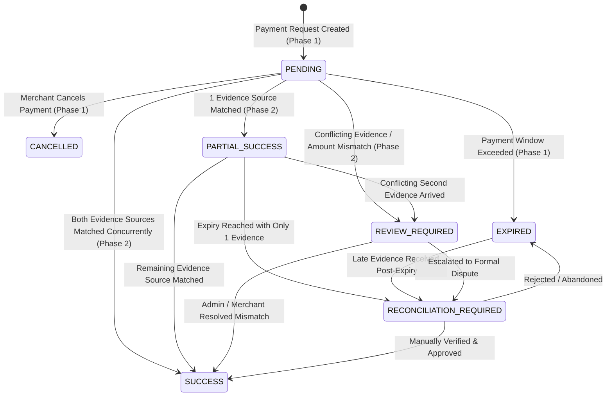

# Payment Lifecycle & State Machine

## 1. Payment Status State Diagram

---

## 2. Status Definitions & Phase 1 vs Phase 2 Scope

| Status | Phase Implemented | Trigger Condition | Next Allowed States |
|---|---|---|---|
| `PENDING` | Phase 1 | Order created, QR rendered, awaiting payment | `CANCELLED`, `EXPIRED`, `PARTIAL_SUCCESS`, `SUCCESS`, `REVIEW_REQUIRED` |
| `CANCELLED` | Phase 1 | Explicit merchant cancellation via `POST /v1/payments/:id/cancel` | *Terminal state* |
| `EXPIRED` | Phase 1 | Timeout reached with zero matching evidence | `RECONCILIATION_REQUIRED` (if late evidence arrives) |
| `PARTIAL_SUCCESS` | Phase 2 | Exactly one verified evidence channel captured | `SUCCESS`, `REVIEW_REQUIRED`, `RECONCILIATION_REQUIRED` |
| `SUCCESS` | Phase 2 | Both Email AND Android Companion evidence matched to same bank transaction | *Terminal state* (Cannot be downgraded) |
| `REVIEW_REQUIRED` | Phase 2 | Conflicting details (amount mismatch, wrong reference, UTR conflict) | `SUCCESS`, `RECONCILIATION_REQUIRED` |
| `RECONCILIATION_REQUIRED` | Phase 2 | Evidence arrived after payment window or requires manual UTR review | `SUCCESS`, `EXPIRED` |

---

## 3. Invariant Business Rules

1. **Phase 1 Restriction**: In Phase 1, payments **NEVER** reach `SUCCESS` or `PARTIAL_SUCCESS` because evidence ingestion is introduced in Phase 2. All payments exist strictly in `PENDING`, `CANCELLED`, or `EXPIRED`.
2. **No Timeout Promotion**: Expiration of a timer must **NEVER** promote a `PARTIAL_SUCCESS` payment to `SUCCESS`. If a payment times out while in `PARTIAL_SUCCESS`, it moves to `RECONCILIATION_REQUIRED`.
3. **One UTR to One Order**: A unique bank transaction reference (UTR) can only be matched to a single `payment_request`. Any subsequent match attempt with the same UTR is flagged as `CONFLICTING` / `DUPLICATE` and triggers `REVIEW_REQUIRED`.
4. **Cancellation Invariant**: Only `PENDING` payments can be cancelled. Once a payment has expired or received evidence, it cannot be transitioned to `CANCELLED`.
5. **Paise Accuracy**: All financial amounts are stored as integer paise (1 INR = 100 paise) to eliminate floating-point rounding errors.
