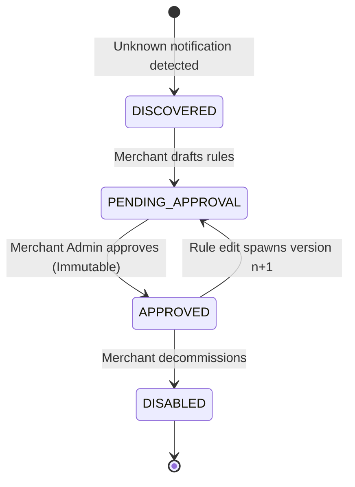

# PHASE 2A: EVIDENCE ARCHITECTURE & DATA FOUNDATION

## 1. Executive Summary & Core Architectural Invariants

Phase 2A establishes the foundational data models, provider-independent normalization contracts, deduplication mechanisms, template lifecycle management, and privacy-preserving security controls for the **RGS Ledger Dual-Source Evidence Engine**.

### Mandatory Product Rules & Boundaries
1. **Dual-Source Evidence Policy**: RGS Ledger verifies payments through independent evidence matching across two distinct logical channels:
   - **`EMAIL`**: Bank credit alert emails (with Gmail and Outlook functioning as providers of **one** single logical channel).
   - **`ANDROID`**: In-device push notifications captured by the Android Companion app.
2. **Strict FinTech & Rail Disclosures**:
   - RGS Ledger **DOES NOT** hold merchant or customer funds.
   - RGS Ledger **DOES NOT** connect to direct bank APIs or scrape online banking portals.
   - RGS Ledger **DOES NOT** integrate with payment aggregator APIs for settlement or payment status verification.
   - Payment `SUCCESS` certifies that the dual-source evidence policy was satisfied, NOT that RGS Ledger received an authoritative bank rail signal.
3. **Phase 2A Invariant**: In Phase 2A, **NO** payment request is ever marked `SUCCESS`. Payments remain `PENDING`, `EXPIRED`, or `CANCELLED`. Evidence matching orchestration will be introduced in Phase 2B.

---

## 2. Evidence Data Models & Mongoose Schemas

All evidence entities reside in `apps/api/src/database/models.ts` and domain types in `packages/shared-types/src/index.ts`. Every entity enforces tenant isolation via mandatory `merchantId`.

### 2.1. Payment Evidence (`payment_evidence`)
Stores provider-independent normalized payment evidence.

```typescript
const PaymentEvidenceSchema = new Schema(
  {
    merchantId: { type: Schema.Types.ObjectId, ref: 'merchants', required: true, index: true },
    channel: { type: String, enum: ['EMAIL', 'ANDROID'], required: true, index: true },
    provider: { type: String, enum: ['GMAIL', 'OUTLOOK', 'ANDROID_COMPANION'], required: true, index: true },
    source: { type: String, enum: ['EMAIL_GMAIL', 'EMAIL_OUTLOOK', 'ANDROID_COMPANION'], required: true, index: true },
    providerMessageId: { type: String, required: true, index: true },
    senderOrPackage: { type: String, required: true, index: true },
    accountIdentifier: { type: String, default: null },
    transactionType: { type: String, enum: ['CREDIT', 'DEBIT'], default: 'CREDIT', index: true },
    amountPaise: { type: Number, required: true, index: true },
    currency: { type: String, default: 'INR' },
    utr: { type: String, index: true, default: null },
    payerVpa: { type: String },
    payerName: { type: String },
    receiverVpa: { type: String },
    bankReference: { type: String },
    transactionTimestamp: { type: Date, default: null },
    receivedAt: { type: Date, default: Date.now, index: true },
    status: {
      type: String,
      enum: ['RECEIVED', 'NORMALIZED', 'MATCHED', 'UNMATCHED', 'DUPLICATE', 'REJECTED', 'REVIEW_REQUIRED'],
      default: 'UNMATCHED',
      index: true
    },
    rejectionReason: { type: String },
    deduplicationHash: { type: String, required: true, index: true },
    rawPayloadHash: { type: String, required: true, index: true },
    encryptedRawPayload: { type: String },
    templateId: { type: Schema.Types.ObjectId, ref: 'evidence_templates' },
    templateVersion: { type: Number },
    matchedPaymentRequestId: { type: Schema.Types.ObjectId, ref: 'payment_requests' },
    matchedAt: { type: Date },
    capturedAt: { type: Date, default: Date.now },
    metadata: { type: Schema.Types.Mixed }
  },
  { timestamps: true }
);

// Indexes
PaymentEvidenceSchema.index({ merchantId: 1, deduplicationHash: 1 }, { unique: true });
PaymentEvidenceSchema.index({ merchantId: 1, rawPayloadHash: 1 });
PaymentEvidenceSchema.index({ merchantId: 1, status: 1 });
PaymentEvidenceSchema.index({ merchantId: 1, utr: 1 });
PaymentEvidenceSchema.index({ merchantId: 1, amountPaise: 1, status: 1 });
PaymentEvidenceSchema.index({ merchantId: 1, provider: 1, providerMessageId: 1 });
```

### 2.2. Evidence Templates (`evidence_templates`)
Merchant-scoped regex templates for extracting fields from notification alerts.

```typescript
const EvidenceTemplateSchema = new Schema(
  {
    merchantId: { type: Schema.Types.ObjectId, ref: 'merchants', required: true, index: true },
    channel: { type: String, enum: ['EMAIL', 'ANDROID'], required: true, index: true },
    provider: { type: String, enum: ['GMAIL', 'OUTLOOK', 'ANDROID_COMPANION'] },
    senderIdentifier: { type: String, required: true, index: true },
    name: { type: String, required: true },
    description: { type: String },
    regexPattern: { type: String, required: true },
    fieldsMap: {
      amountPaiseExtractor: { type: String },
      utrExtractor: { type: String },
      accountExtractor: { type: String },
      transactionTimestampExtractor: { type: String },
      transactionTypeExtractor: { type: String }
    },
    version: { type: Number, default: 1 },
    status: {
      type: String,
      enum: ['DISCOVERED', 'PENDING_APPROVAL', 'APPROVED', 'DISABLED'],
      default: 'DISCOVERED',
      index: true
    },
    isImmutable: { type: Boolean, default: false },
    approvedByUserId: { type: Schema.Types.ObjectId, ref: 'users' },
    approvedAt: { type: Date },
    history: [TemplateVersionHistorySchema]
  },
  { timestamps: true }
);

EvidenceTemplateSchema.index({ merchantId: 1, senderIdentifier: 1, channel: 1 });
EvidenceTemplateSchema.index({ merchantId: 1, status: 1 });
```

### 2.3. Evidence Ingestion Attempts (`evidence_ingestion_attempts`)
Immutable log of every inbound evidence ingestion request for audit, diagnostics, and retry idempotency.

```typescript
const EvidenceIngestionAttemptSchema = new Schema(
  {
    merchantId: { type: Schema.Types.ObjectId, ref: 'merchants', required: true, index: true },
    channel: { type: String, enum: ['EMAIL', 'ANDROID'], required: true },
    provider: { type: String, enum: ['GMAIL', 'OUTLOOK', 'ANDROID_COMPANION'], required: true },
    providerMessageId: { type: String, required: true, index: true },
    idempotencyKey: { type: String, index: true },
    ipAddress: { type: String },
    status: { type: String, enum: ['SUCCESS', 'DUPLICATE', 'FAILED'], required: true, index: true },
    evidenceId: { type: Schema.Types.ObjectId, ref: 'payment_evidence' },
    errorMessage: { type: String },
    attemptedAt: { type: Date, default: Date.now, index: true }
  },
  { timestamps: true }
);

EvidenceIngestionAttemptSchema.index({ merchantId: 1, provider: 1, providerMessageId: 1 });
EvidenceIngestionAttemptSchema.index({ merchantId: 1, attemptedAt: -1 });
```

### 2.4. Payment Evidence Associations (`payment_evidence_associations`)
Tracks associations between payment requests and evidence records.

```typescript
const PaymentEvidenceAssociationSchema = new Schema(
  {
    merchantId: { type: Schema.Types.ObjectId, ref: 'merchants', required: true, index: true },
    paymentRequestId: { type: Schema.Types.ObjectId, ref: 'payment_requests', required: true, index: true },
    evidenceId: { type: Schema.Types.ObjectId, ref: 'payment_evidence', required: true, index: true },
    channel: { type: String, enum: ['EMAIL', 'ANDROID'], required: true },
    provider: { type: String, enum: ['GMAIL', 'OUTLOOK', 'ANDROID_COMPANION'], required: true },
    matchedUtr: { type: String, index: true },
    matchedAmountPaise: { type: Number, required: true },
    associatedAt: { type: Date, default: Date.now },
    associatedBy: { type: String, enum: ['AUTO_MATCH', 'MANUAL_RECONCILIATION'], default: 'AUTO_MATCH' }
  },
  { timestamps: true }
);

PaymentEvidenceAssociationSchema.index({ merchantId: 1, paymentRequestId: 1 });
PaymentEvidenceAssociationSchema.index({ merchantId: 1, evidenceId: 1 }, { unique: true });
```

---

## 3. Evidence Normalization Rules

The normalization engine (`EvidenceNormalizer`) accepts raw data from any supported provider and converts it to a standard domain contract (`NormalizedEvidence`).

1. **Integer Paise Representation**:
   - `amountPaise` is strictly an integer representing the smallest currency unit.
   - String or decimal rupee amounts are converted via `Math.round(rupees * 100)` (e.g. `1,250.50` -> `125050`).
   - Currency is invariant: `'INR'`.
2. **UTR Standardization**:
   - UTRs are validated against `^[a-zA-Z0-9]{10,22}$`.
   - If not present or malformed, `utr` is set strictly to `null`. Synthetic or fabricated UTRs are **strictly prohibited**.
3. **Missing Fields Policy**:
   - Any unextracted field (`accountIdentifier`, `transactionTimestamp`, `payerVpa`) remains `null` or `undefined`.
4. **Credit vs. Debit Classification**:
   - Incoming messages are classified into `CREDIT` or `DEBIT`.
   - If classified as `DEBIT`:
     - `transactionType: TransactionType.DEBIT`
     - `status: EvidenceStatus.REJECTED`
     - `rejectionReason: 'DEBIT_TRANSACTION_IGNORED'`
     - Debit evidence records can **never** be matched to payment requests.

---

## 4. Deduplication & Idempotency Architecture

To prevent duplicate evidence ingestion, race conditions, or replay attacks:

1. **Raw Payload Hash**:
   $$\text{rawPayloadHash} = \text{SHA-256}(\text{rawText})$$
2. **Canonical Deduplication Hash**:
   $$\text{deduplicationHash} = \text{SHA-256}(\text{merchantId} \,\|\, \text{channel} \,\|\, \text{provider} \,\|\, \text{providerMessageId} \,\|\, \text{payloadSnippet})$$
3. **Database Unique Constraint**:
   A unique compound index on `{ merchantId: 1, deduplicationHash: 1 }` prevents concurrent or duplicate inserts.
4. **Idempotent Ingestion Flow**:
   - Checks if `deduplicationHash` exists under `merchantId`.
   - If found: creates an `EvidenceIngestionAttempt` record with `status: 'DUPLICATE'`, returns HTTP 200 with `isDuplicate: true` and the existing `evidenceId`.
   - If new: creates the `PaymentEvidence` record, marks the attempt as `SUCCESS`, and returns HTTP 201.

---

## 5. Template Lifecycle & Version Immutability

Merchant templates follow an immutable state machine:



### Invariant Rules:
1. **Never Auto-Approved**: Discovered templates default to `DISCOVERED` or `PENDING_APPROVAL` and require merchant authorization.
2. **Version Immutability**:
   - When a template is `APPROVED`, `isImmutable` is set to `true`.
   - If a merchant modifies `regexPattern` or `fieldsMap`, the existing approved version ($n$) is frozen and archived into the `history` array.
   - A new version ($n+1$) is created in `PENDING_APPROVAL` with `isImmutable: false`.
3. **Disabled Templates**:
   - Cannot be used for regex matching or field extraction.
   - Throws error if an update is attempted.

---

## 6. Security, Privacy & Tenant Isolation

1. **AES-256-GCM Encryption at Rest**:
   - All raw notification texts are encrypted at rest using AES-256-GCM with a 32-byte key (`config.ENCRYPTION_KEY_HEX`) and unique 96-bit IV.
   - Ciphertext format: `${ivHex}:${authTagHex}:${cipherHex}`.
2. **Account Masking**:
   - Bank account numbers are masked (`EvidenceSecurity.maskAccountNumber`), preserving only the final 4 digits (`••••••••1234`).
3. **Sensitive Field Scrubbing**:
   - Text redaction replaces OTPs, verification codes, and passwords with `[REDACTED]`.
   - Object scrubbing recursively sanitizes sensitive keys (`token`, `password`, `pin`, `cvv`, `secret`).
4. **Mandatory Tenant Scoping**:
   - Every database query for templates, evidence, and ingestion attempts is strictly bound to `merchantId`.

---

## 7. Verification & Test Evidence

```
Total Test Suites: 19
Total Unit & Integration Tests: 66
Passing: 66
Failing: 0
TypeScript Errors (12 workspaces): 0
Production Build: Exit Code 0 (Zero warnings)
```

| Test Suite | Tests | Verification Purpose |
| :--- | :---: | :--- |
| `normalization.test.ts` | 6 | Validates Email/Android mapping, paise accuracy, UTR checks, debit rejection |
| `security.test.ts` | 5 | Validates AES-256-GCM roundtrip, tampering detection, account masking, redaction |
| `template-lifecycle.test.ts` | 5 | Validates immutability, version $n+1$ branching, history archival, extraction |
| `deduplication.test.ts` | 4 | Validates canonical hash generation, duplicate detection, idempotent replies |
| Core API & Adapter Tests | 46 | Authentication, UPI adapter, image QR decoding, security utilities, models |
