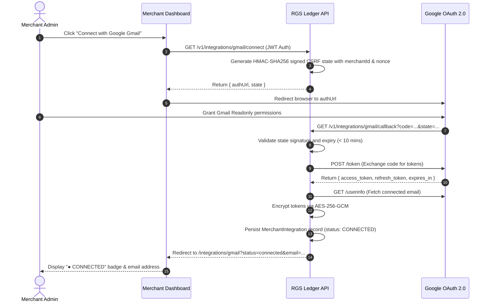

# PHASE 2B: GMAIL OAUTH INTEGRATION & EVIDENCE INGESTION

## 1. Architectural Purpose & Boundaries

Phase 2B implements **Google Gmail OAuth 2.0 integration** as the first live evidence ingestion provider for RGS Ledger.

### Invariant Product Boundaries:
1. **One Logical Email Channel**: In the RGS Ledger Dual-Source verification architecture, Gmail and Outlook are providers of **one** single logical evidence channel (`EvidenceChannel.EMAIL`). Receiving two email alerts for the same transaction does **NOT** satisfy the dual-source rule (an Android Companion push notification is still required in Phase 3).
2. **Strict FinTech Rail Boundaries**:
   - RGS Ledger **DOES NOT** hold customer or merchant money.
   - RGS Ledger **DOES NOT** connect to direct bank APIs or scrape online banking statements.
   - RGS Ledger **DOES NOT** execute bank settlement.
   - Payment `SUCCESS` certifies dual-source evidence satisfaction, NOT direct bank rail confirmation.
3. **Phase 2B Isolation**: In Phase 2B, **NO** payment request is marked `SUCCESS`. Evidence records remain `UNMATCHED`, `REJECTED`, or `DUPLICATE`. Evidence-to-payment matching will be introduced in Phase 2C.

---

## 2. Google Cloud Platform & OAuth 2.0 Setup

### 2.1. Google Cloud Console Configuration
1. Navigate to the [Google Cloud Console](https://console.cloud.google.com/).
2. Create a new project (e.g. `rgs-ledger-production` or `rgs-ledger-dev`).
3. Enable the **Gmail API** in `APIs & Services > Library`.
4. Configure the **OAuth Consent Screen**:
   - User Type: **External** (for multi-tenant merchant onboarding).
   - App Name: `RGS Ledger`.
   - User Support Email & Developer Contact Information.
   - Scopes:
     - `https://www.googleapis.com/auth/gmail.readonly` (Read resources, metadata, and messages).
     - `https://www.googleapis.com/auth/userinfo.email` (Identify connected account).
   - Test Users: Add test merchant Gmail addresses while the app is in "Testing" mode.
5. Create **OAuth 2.0 Client Credentials**:
   - Application Type: **Web application**.
   - Authorized JavaScript origins:
     - `http://localhost:3000` (Merchant Dashboard)
     - `http://localhost:4000` (API Server)
   - Authorized redirect URIs:
     - `http://localhost:4000/v1/integrations/gmail/callback` (or `/api/v1/integrations/gmail/callback`).

### 2.2. Environment Variables Configuration
In your backend `.env` file (see [`.env.example`](file:///d:/Coding/project/RGS_PAY/.env.example)):
```ini
GOOGLE_CLIENT_ID=your_client_id.apps.googleusercontent.com
GOOGLE_CLIENT_SECRET=your_client_secret
GOOGLE_OAUTH_REDIRECT_URI=http://localhost:4000/v1/integrations/gmail/callback
```

---

## 3. OAuth 2.0 Authorization Flow & CSRF State Security



### Key Security Invariants:
1. **CSRF State Protection**: The `state` parameter is an HMAC-SHA256 token containing `{ merchantId, nonce, timestamp }`. State validation checks constant-time signature equality and enforces a 10-minute expiry window.
2. **Zero Frontend Token Exposure**: Access tokens and refresh tokens are exchanged and held strictly on the backend. Frontend JavaScript never receives or stores OAuth credentials.
3. **AES-256-GCM Encryption at Rest**: Tokens are encrypted before storage in MongoDB using the server's master key (`ENCRYPTION_KEY_HEX`).
4. **Mandatory Refresh Token Guarantee**: Requests use `access_type: 'offline'` and `prompt: 'consent'` to guarantee Google issues a refresh token even on re-connections.

---

## 4. Synchronization Engine Architecture

The sync engine (`GmailSyncService`) runs incremental or historical message ingestion.

### 4.1. Targeted Search Query Construction
RGS Ledger does **NOT** crawl entire mailboxes. It queries only relevant financial notifications:
```
(credited OR credit OR received OR INR OR Rs OR UPI) after:<timestamp>
```
- **Initial Sync**: Scans back a configurable lookback window (default: 7 days).
- **Incremental Sync**: Scans from `lastSyncAt` with a 5-minute safety overlap (`- 300s`) to protect against clock drift or delayed email delivery.

### 4.2. Quota-Optimized Deduplication
Before fetching the full email body (which costs Gmail quota and network bandwidth), RGS Ledger computes the deduplication hash:
$$\text{deduplicationHash} = \text{SHA-256}(\text{merchantId} \,\|\, \text{'EMAIL'} \,\|\, \text{'GMAIL'} \,\|\, \text{message.id})$$
If the hash already exists in `PaymentEvidenceModel`, the message is counted as a duplicate and full payload retrieval is **skipped entirely**.

### 4.3. Token Auto-Refresh & Revocation Handling
- If the access token is within 60 seconds of expiration, `GmailSyncService` auto-refreshes the token before querying Gmail.
- If Google returns `invalid_grant` (e.g. user revoked permissions in their Google Account security settings), the integration status updates immediately to `REVOKED` and the error message is recorded with personal identifiers redacted.

---

## 5. Email Classification & Evidence Normalization

1. **Extraction**:
   - Checks if the merchant has an active, approved `EvidenceTemplate` for the sender.
   - If found: extracts amount, UTR, and account identifier using the template's regex pattern.
   - If no custom template exists: extracts fields using standard bank notification patterns.
2. **Classification & Invariant Rules**:
   - **Credit Alerts**: Normalized and stored in `PaymentEvidenceModel` with `status: EvidenceStatus.UNMATCHED`.
   - **Debit Alerts**: Classified as `TransactionType.DEBIT` and stored with `status: EvidenceStatus.REJECTED` (`rejectionReason: 'DEBIT_TRANSACTION_IGNORED'`). Debit alerts **never** satisfy payment requests.
   - **Missing Optional Fields**: UTRs or account identifiers that cannot be parsed are strictly stored as `null`. Synthetic references are never invented.
   - **Paise Conversion**: All amounts are normalized to integer paise (e.g. `₹1,500.00` -> `150000`).

---

## 6. Merchant Dashboard Implementation

The merchant dashboard (`apps/merchant-dashboard/src/App.tsx`) incorporates:

1. **Gmail Evidence Integration Card**:
   - Connection status badge (`CONNECTED` in green, `DISCONNECTED` in gray, `REVOKED` in red).
   - Connected Gmail address display.
   - Last successful sync timestamp.
   - Safely redacted sync error display.
   - Sync metrics: total processed, new evidence records, duplicate count.
   - Actions: **Connect with Google Gmail**, **↻ Sync Now**, and **Disconnect** (which revokes Google tokens).
2. **Ingested Payment Evidence Feed**:
   - Real-time table displaying normalized evidence items.
   - Shows: Amount (₹ and paise), Type (`CREDIT` vs `DEBIT`), UTR / Reference, Masked Account (`••••1234`), Sender, Date, and Processing Status (`UNMATCHED`, `MATCHED`, `REJECTED`).
   - Sensitive email body content is redacted by default.

---

## 7. Automated Test Suite & Verification

All automated tests use mocked Gmail API responses and in-memory repositories. Real merchant inboxes are never accessed during automated tests.

```
Total Test Suites: 21
Total Unit & Integration Tests: 81
Passing: 81
Failing: 0
TypeScript Errors (12 workspaces): 0
Production Build: Exit Code 0 (Zero warnings)
```

| Test File | Tests | Coverage |
| :--- | :---: | :--- |
| [`gmail-oauth.test.ts`](file:///d:/Coding/project/RGS_PAY/apps/api/src/modules/integrations/gmail-oauth.test.ts) | 9 | State generation, CSRF tampering detection, expiry, authorization URL formatting, code-for-token exchange, auto-refresh, revoked token handling (`invalid_grant`), AES-256-GCM token encryption/decryption, user email lookup |
| [`gmail-sync.test.ts`](file:///d:/Coding/project/RGS_PAY/apps/api/src/modules/integrations/gmail-sync.test.ts) | 6 | Targeted financial query construction, pagination across pages, quota-saving duplicate pre-check, credit alert ingestion (`UNMATCHED`), debit alert rejection (`DEBIT_TRANSACTION_IGNORED`), revoked credentials handling, tenant isolation |
| Evidence & Template Tests | 20 | Normalization, deduplication, template version immutability, security |
| Core API & Adapter Tests | 46 | Auth, UPI adapter, QR decoding, checkout, security utilities |

---

## 8. Manual Testing Procedure (Live Gmail OAuth)

When testing with a live Google Cloud project:

1. **Configure Environment**:
   ```bash
   GOOGLE_CLIENT_ID="<your-client-id>.apps.googleusercontent.com"
   GOOGLE_CLIENT_SECRET="<your-client-secret>"
   GOOGLE_OAUTH_REDIRECT_URI="http://localhost:4000/v1/integrations/gmail/callback"
   ```
2. **Start Services**:
   ```bash
   # Terminal 1: API
   npm run dev --workspace=@rgs-ledger/api

   # Terminal 2: Merchant Dashboard
   npm run dev --workspace=@rgs-ledger/merchant-dashboard
   ```
3. **Execute Connection**:
   - Log in to the Merchant Dashboard at `http://localhost:3000`.
   - Under **Gmail Evidence**, click **Connect with Google Gmail**.
   - Authenticate with your test Google Account on the Google consent screen.
   - Upon redirect, confirm the dashboard displays `● CONNECTED` with your email address.
4. **Execute Sync**:
   - Send a sample bank credit alert email to the connected Gmail inbox (e.g., `A/c XX1234 credited with INR 500.00. UPI Ref: 123456789012`).
   - Click **↻ Sync Now** in the dashboard.
   - Confirm that the evidence appears under **Ingested Payment Evidence** with status `UNMATCHED`, amount `₹500.00`, and masked account.
   - Click **↻ Sync Now** again and verify that the duplicate count increases while the evidence count remains unchanged.
5. **Execute Disconnection**:
   - Click **Disconnect**. Confirm status returns to `○ DISCONNECTED` and stored tokens are wiped.
